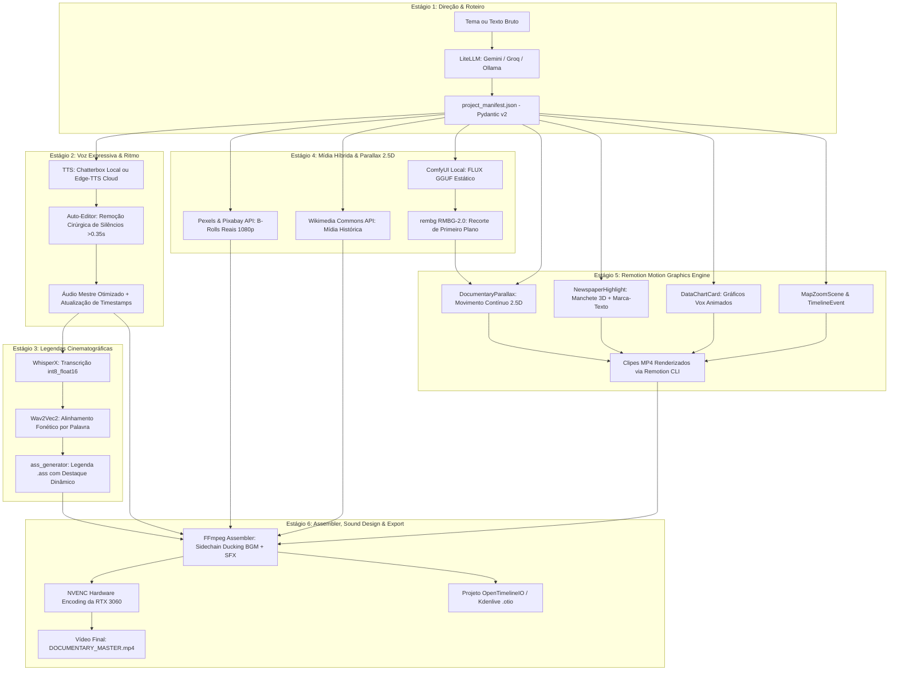

# 🎬 Guia Mestre e Especificação Arquitetural Definitiva: Estúdio Inteligente de Documentários
> **Projeto:** `D:\IA\editor_inteligente`  
> **Objetivo:** Automação completa de edição de vídeos estilo documentário cinematográfico/investigativo (*Vox*, *Johnny Harris*, *Fern*, *Lemmino*, *Magnates*) a partir de temas ou roteiros brutos.  
> **Versão:** 2.0 (Fusão Consolidada: Engenharia Modular + Motion Design Anti-Jitter)  
> **Data:** Outubro de 2026  

---

## 1. Diretrizes Inegociáveis (Guardrails do Projeto)

1. **Proibição Estrita do `zoompan` do FFmpeg:**  
   Todo movimento de câmera em imagens estáticas (*slow zoom*, *pan*, *drift*, *tilt* e efeito Ken Burns) e composições em profundidade **deve ser processado exclusivamente pelo Remotion**, utilizando interpolação contínua de sub-pixel com ponto flutuante em WebGL/CSS (`interpolate()`, `spring()`). Eliminação total de *pixel jitter* e trepidação.
2. **Eliminação de Geradores de Vídeo IA Pesados (Sem LTX-Video / Wan2GP):**  
   Não utilizamos modelos DiT de geração de vídeo na esteira padrão. A retenção visual e a dinâmica são alcançadas através do tripé:
   * **B-rolls reais e arquivos históricos em 1080p** (Pexels, Pixabay, Wikimedia Commons).
   * **Ilustrações conceituais estáticas com IA** (FLUX.1-schnell/Dev GGUF em ~6 a 8 segundos).
   * **Parallax 2.5D com recorte RMBG-2.0 via `rembg`** animado no Remotion.
   * **Animações gráficas programáticas** (mapas, dados, manchetes com marca-texto, linhas do tempo).  
   *Ganho: Renderização de 30x a 50x mais rápida, zero risco de OOM (Out Of Memory) e estética limpa sem deformações temporais.*
3. **Execução Estritamente Sequencial por Fases (State-Machine Pipeline):**  
   Com 12 GB de VRAM, **nunca instancie dois motores de IA na memória simultaneamente**. Cada etapa roda isolada, salva seu progresso no `project_manifest.json` e chama rotina obrigatória de descarregamento de VRAM.
4. **Single Source of Truth (`project_manifest.json`):**  
   Todas as etapas leem e gravam seu estado em um único manifesto validado por **Pydantic v2**, permitindo retomada automática (*checkpointing*) de onde parou em caso de interrupção.
5. **Renderização Acelerada por Hardware (NVENC):**  
   Toda codificação final e composição é acelerada pelo encoder dedicado da RTX 3060 (`h264_nvenc -preset p4 -rc vbr -cq 19`).

---

## 2. Diagnóstico de Hardware e Orçamento de Memória

### 2.1 Especificações da Máquina
* **CPU:** AMD Ryzen 5 5500 (6 Núcleos / 12 Threads) — alocação máxima de 8 threads para o pipeline, garantindo fluidez do Windows.
* **Memória RAM:** 24 GB DDR4 — buffer ideal para offload de pesos quantizados GGUF e compilação de frames do Chromium/Remotion.
* **GPU:** NVIDIA GeForce RTX 3060 (12 GB VRAM dedicada, Driver 616.56+, CUDA 12.4/13.x).
* **Armazenamento:**
  * `D:` (SSD de Trabalho): Armazena workspace ativa, cache de compilação e assets do projeto atual.
  * `E:` / `F:` (HDDs Secundários): Repositório de longo prazo para bibliotecas de SFX, B-rolls e vídeos finais renderizados.

### 2.2 Tabela de Uso Sequencial de VRAM & Teardown

| Estágio | Ferramenta | Consumo de VRAM | Ação Pós-Execução (`vram_guard.py`) |
| :--- | :--- | :--- | :--- |
| **Estágio 1: Roteiro & Direção** | LiteLLM (Gemini 2.5 Flash / Groq) com fallback Ollama local | 0 MB (Nuvem) ou ~5.0 GB (Ollama Qwen 2.5 7B Q4) | Se Ollama: `keep_alive=0` via API |
| **Estágio 2: Narração & Ritmo** | `edge-tts` (Nuvem) ou `Chatterbox` / `F5-TTS` (Local) + `auto-editor` | 0 MB (Nuvem) ou ~3.5 GB (Chatterbox) | `gc.collect(); torch.cuda.empty_cache()` |
| **Estágio 3: Alinhamento & Legendas** | `WhisperX` (large-v3-turbo / `int8_float16`) + Wav2Vec2 | ~3.2 a 4.0 GB | `del model; flush_vram()` |
| **Estágio 4: Mídia & Parallax** | Pexels/Pixabay/Wikimedia + ComfyUI (FLUX GGUF) + `rembg` | 0 MB (APIs) ou ~7.5 a 8.5 GB (ComfyUI FLUX) | POST `/free` no ComfyUI + descarrega ONNX |
| **Estágio 5: Gráficos & Parallax Remotion** | Remotion v4+ (React + WebGL) | ~1.5 a 2.0 GB (Chromium) | Processo Node encerra ao compilar |
| **Estágio 6: Montagem Final & NVENC** | FFmpeg NVENC + OpenTimelineIO | ~1.5 GB (Chip NVENC) | Liberação final de recursos |

---

## 3. Arquitetura do Sistema e Fluxo de Dados



---

## 4. O Contrato Central: `project_manifest.json`

O estado de cada projeto é centralizado neste formato JSON, gerenciado por modelos Pydantic v2 em `src/core/manifest.py`:

```json
{
  "project_id": "doc_crise_subprime_2008",
  "title": "O Efeito Dominó de 2008",
  "fps": 30,
  "resolution": { "width": 1920, "height": 1080 },
  "stage_status": {
    "stage1_director": "completed",
    "stage2_audio": "completed",
    "stage3_captions": "completed",
    "stage4_broll": "completed",
    "stage5_motion": "in_progress",
    "stage6_assembler": "pending"
  },
  "audio_master": "workspace/doc_crise_subprime_2008/audio/narration_trimmed.wav",
  "captions_ass": "workspace/doc_crise_subprime_2008/captions/dynamic_words.ass",
  "bgm_track": "assets/bgm/dark_investigative_ambient.mp3",
  "scenes": [
    {
      "scene_id": 1,
      "narration_text": "Em setembro de 2008, um único gráfico escondeu o colapso de quarenta bilhões de dólares.",
      "start_time": 0.0,
      "end_time": 6.2,
      "visual_type": "remotion_graphic",
      "visual_config": {
        "template": "DataChartCard",
        "props": {
          "headline": "Exposição Subprime Global (US$ Trilhões)",
          "source_label": "Fonte: Relatório da Comissão Financeira",
          "data_points": [
            { "year": "2004", "value": 1.2 },
            { "year": "2006", "value": 4.8 },
            { "year": "2008", "value": 11.4 }
          ],
          "theme": "vox_dark_grid"
        }
      },
      "sfx": [
        { "name": "whoosh_deep.wav", "offset_sec": 0.0 },
        { "name": "digital_beep.wav", "offset_sec": 1.4 }
      ],
      "rendered_clip_path": "workspace/doc_crise_subprime_2008/motion_renders/scene_01.mp4"
    },
    {
      "scene_id": 2,
      "narration_text": "Nas ruas de Nova York, o pânico começou antes da abertura dos mercados.",
      "start_time": 6.2,
      "end_time": 10.8,
      "visual_type": "stock_broll",
      "visual_config": {
        "search_query": "wall street crowd rush panic morning",
        "source": "pexels"
      },
      "sfx": [
        { "name": "sub_bass_hit.wav", "offset_sec": 0.0 }
      ],
      "rendered_clip_path": "workspace/doc_crise_subprime_2008/brolls/scene_02.mp4"
    },
    {
      "scene_id": 3,
      "narration_text": "Richard Fuld, o CEO do Lehman Brothers, insistia que o banco era inquebrável.",
      "start_time": 10.8,
      "end_time": 15.5,
      "visual_type": "parallax_25d",
      "visual_config": {
        "image_source": "wikimedia",
        "query": "Richard Fuld Lehman Brothers",
        "camera_motion": "slow_push_dramatic",
        "blur_background": 8.0
      },
      "sfx": [
        { "name": "camera_shutter.wav", "offset_sec": 0.2 },
        { "name": "paper_slide.wav", "offset_sec": 0.5 }
      ],
      "rendered_clip_path": "workspace/doc_crise_subprime_2008/motion_renders/scene_03.mp4"
    }
  ]
}
```

---

## 5. Estrutura de Diretórios Unificada

```text
D:\IA\editor_inteligente/
├── PLANO_DE_REQUISITOS_E_ARQUITETURA.md  <-- Este Guia Mestre Consolidado
├── config.yaml                          <-- Parâmetros do hardware, NVENC, threads e modelos
├── .env.example                         <-- GEMINI_API_KEY, GROQ_API_KEY, PEXELS_API_KEY
├── requirements.txt                     <-- Dependências Python (Pydantic, LiteLLM, WhisperX, etc.)
├── main.py                              <-- CLI Orquestrador com máquina de estados (--stage, --resume)
│
├── src/                                 <-- Módulos da Esteira (Python)
│   ├── core/
│   │   ├── manifest.py                  <-- Modelos Pydantic v2 do project_manifest.json
│   │   └── vram_guard.py                <-- Gerenciador de limpeza de VRAM e descarregamento de modelos
│   ├── stage1_director/
│   │   └── script_director.py           <-- LiteLLM + Ollama: Gera roteiro estruturado por cenas
│   ├── stage2_audio/
│   │   ├── tts_engine.py                <-- Wrapper Chatterbox / F5-TTS / Edge-TTS
│   │   └── silence_cutter.py            <-- Auto-Editor para otimização de ritmo e silêncios
│   ├── stage3_captions/
│   │   ├── aligner.py                   <-- WhisperX + Faster-Whisper (alinhamento Wav2Vec2)
│   │   └── ass_generator.py             <-- Gerador de legendas .ass dinâmicas com highlight
│   ├── stage4_broll/
│   │   ├── pexels_fetcher.py            <-- Download de B-rolls via API Pexels / Pixabay
│   │   ├── wikimedia_fetcher.py         <-- Download de mídias históricas do Wikimedia Commons
│   │   ├── comfy_client.py              <-- Cliente headless para ComfyUI (FLUX GGUF)
│   │   └── parallax_segmenter.py        <-- Recorte de sujeito com RMBG-2.0 via rembg
│   ├── stage5_motion/
│   │   └── remotion_bridge.py           <-- Ponte Python -> Remotion CLI com injeção de props
│   └── stage6_assembler/
│       ├── ffmpeg_composer.py           <-- Composição mestre, ducking, SFX e render NVENC
│       └── otio_exporter.py             <-- Exportador de projeto OpenTimelineIO / Kdenlive
│
├── remotion_graphics/                   <-- Projeto Remotion (React + TypeScript + Tailwind)
│   ├── package.json
│   ├── remotion.config.ts
│   └── src/
│       ├── Root.tsx                     <-- Ponto de registro de composições
│       ├── templates/                   <-- Componentes Cinematográficos
│       │   ├── DocumentaryParallax.tsx  <-- Movimento de câmera 2.5D suave (Anti-Zoompan)
│       │   ├── NewspaperHighlight.tsx   <-- Manchete em perspectiva com marca-texto animado
│       │   ├── DataChartCard.tsx        <-- Gráficos de linhas/barras estilo Vox
│       │   ├── MapZoomScene.tsx         <-- Animação vetorial SVG de mapas e rotas
│       │   ├── TimelineEvent.tsx        <-- Linha do tempo horizontal deslizante
│       │   └── LowerThirdTitle.tsx      <-- Identificação cinética de sujeitos/locais
│       └── components/
│           ├── FilmGrainOverlay.tsx     <-- Textura cinematográfica 35mm unificadora
│           └── SafeZones.tsx            <-- Margens para não cobrir UI de players
│
├── assets/                              <-- Banco Permanente de Mídias
│   ├── sfx/                             <-- Whooshes, booms, clicks, papers, typewriter
│   ├── bgm/                             <-- Trilhas sonoras categorizadas (suspense, tensão, reflexão)
│   ├── overlays/                        <-- Texturas de papel envelhecido, poeira e grão 35mm
│   └── fonts/                           <-- Inter, JetBrains Mono, Montserrat, Playfair Display
│
└── workspace/                           <-- Dados por projeto (ex: workspace/doc_crise_subprime_2008/)
    ├── project_manifest.json            <-- Manifesto do projeto
    ├── audio/                           <-- Narrações brutas e pós-auto-editor
    ├── captions/                        <-- JSON word-level e arquivo .ass
    ├── brolls/                          <-- Vídeos e imagens baixados
    ├── motion_renders/                  <-- Cenas geradas pelo Remotion
    └── output/                          <-- DOCUMENTARY_MASTER.mp4 e timeline .otio
```

---

## 6. Configuração Calibrada do Hardware (`config.yaml`)

```yaml
hardware:
  gpu_vram_gb: 12
  system_ram_gb: 24
  cpu_threads_limit: 8          # Deixa 4 threads livres no Ryzen 5 5500 para o SO
  ffmpeg_encoder: "h264_nvenc"  # Chip dedicado da RTX 3060
  ffmpeg_preset: "p4"
  ffmpeg_cq: 19
  ffmpeg_pix_fmt: "yuv420p"

llm:
  primary_provider: "gemini/gemini-2.5-flash" # Rápido, cota gratuita generosa, 0 MB VRAM
  fallback_local_model: "ollama/qwen2.5:7b-instruct-q4_K_M"
  ollama_keep_alive: 0          # Descarrega da GPU imediatamente

tts:
  engine: "edge-tts"            # Opções: "edge-tts" (grátis/zero VRAM) ou "chatterbox" (local GPU)
  edge_voice: "pt-BR-AntonioNeural"
  device: "cuda"

audio_processing:
  auto_editor:
    min_silence_duration: 0.35  # segundos
    margin: 0.12                # segundos de transição suave

captions:
  whisper_model: "large-v3-turbo"
  compute_type: "int8_float16"  # ~3.2 GB VRAM na RTX 3060
  batch_size: 16
  words_per_block: 4
  highlight_color_hex: "&H00FFFF&" # Ciano brilhante

visuals:
  comfyui_url: "http://127.0.0.1:8188"
  flux_gguf_quant: "Q4_K_M"
  remotion_concurrency: 4       # Balanceado para 6 núcleos / 24 GB RAM
  enable_ai_video_generation: false # Mantido FALSE (elimina gargalo e OOM)
```

---

## 7. O Componente Emblemático Anti-Zoompan: `DocumentaryParallax.tsx`

Para ilustrar o compromisso com a renderização pura sem jitter, o componente de Parallax opera com física de sub-pixel:

```tsx
import { AbsoluteFill, interpolate, spring, useCurrentFrame, useVideoConfig, Img } from 'remotion';

interface ParallaxProps {
  backgroundSrc: string;
  foregroundCutoutSrc: string;
  cameraMotion?: 'push_in' | 'drift_left' | 'dramatic_zoom';
}

export const DocumentaryParallax: React.FC<ParallaxProps> = ({
  backgroundSrc,
  foregroundCutoutSrc,
  cameraMotion = 'push_in',
}) => {
  const frame = useCurrentFrame();
  const { fps, durationInFrames } = useVideoConfig();

  // Movimento de câmera calculado com float contínuo em WebGL (Zero Jitter)
  const progress = interpolate(frame, [0, durationInFrames], [0, 1], {
    extrapolateLeft: 'clamp',
    extrapolateRight: 'clamp',
  });

  const bgScale = interpolate(progress, [0, 1], [1.0, 1.12]);
  const bgTranslateX = cameraMotion === 'drift_left' ? interpolate(progress, [0, 1], [0, -30]) : 0;

  const fgScale = interpolate(progress, [0, 1], [1.0, 1.05]);
  const fgTranslateY = interpolate(progress, [0, 1], [0, -15]);

  return (
    <AbsoluteFill style={{ backgroundColor: '#000', overflow: 'hidden' }}>
      {/* Camada de Fundo (com leve desfoque e zoom mais pronunciado) */}
      <AbsoluteFill
        style={{
          transform: `scale(${bgScale}) translateX(${bgTranslateX}px)`,
          filter: 'blur(4px) brightness(0.85)',
        }}
      >
        
      </AbsoluteFill>

      {/* Camada do Sujeito em Primeiro Plano (recorte RMBG-2.0 com sombra projetada) */}
      <AbsoluteFill
        style={{
          transform: `scale(${fgScale}) translateY(${fgTranslateY}px)`,
          filter: 'drop-shadow(0 20px 30px rgba(0,0,0,0.7))',
        }}
      >
        
      </AbsoluteFill>
    </AbsoluteFill>
  );
};
```

---

## 8. Roteiro de Implementação por Etapas

### Fase 1: Fundação do Ambiente & Core (Imediata)
1. Criar a árvore de diretórios oficial (`src/`, `assets/`, `workspace/`, `remotion_graphics/`).
2. Configurar `config.yaml`, `.env.example` e `requirements.txt`.
3. Implementar `src/core/manifest.py` (Pydantic v2) e `src/core/vram_guard.py` (limpeza forçada de VRAM).
4. Inicializar o projeto Remotion em `remotion_graphics/` com TypeScript e Tailwind.

### Fase 2: Áudio, Ritmo & Sincronia Fonética (Estágios 1, 2 e 3)
1. `src/stage1_director/script_director.py`: geração de roteiro via LiteLLM estruturado no schema do manifest.
2. `src/stage2_audio/tts_engine.py` (Edge-TTS / Chatterbox) + `silence_cutter.py` (Auto-Editor).
3. `src/stage3_captions/aligner.py` (WhisperX Wav2Vec2) + `ass_generator.py` (legendas com highlight ciano).

### Fase 3: Mídia Contextual & Parallax 2.5D (Estágio 4)
1. `src/stage4_broll/pexels_fetcher.py` e `wikimedia_fetcher.py` (busca automatizada de vídeos e mídias históricas).
2. `src/stage4_broll/comfy_client.py` (gerador headless de imagens conceituais FLUX GGUF).
3. `src/stage4_broll/parallax_segmenter.py` (recorte automático via RMBG-2.0).

### Fase 4: Templates do Remotion & Bridge (Estágio 5)
1. Criar os templates: `DocumentaryParallax`, `NewspaperHighlight`, `DataChartCard`, `MapZoomScene`, `TimelineEvent`.
2. Implementar `src/stage5_motion/remotion_bridge.py` para disparar renders parciais baseados no manifesto.
3. Ativar o servidor WebMCP para inspeção pelo agente.

### Fase 5: Montador Final NVENC & Orquestrador CLI (Estágio 6)
1. `src/stage6_assembler/ffmpeg_composer.py`: composição mestre, sidechain ducking de BGM, queima de legendas `.ass` e render NVENC.
2. `src/stage6_assembler/otio_exporter.py`: exportação da timeline completa para Kdenlive/OpenTimelineIO.
3. `main.py`: CLI orquestrador completo com suporte a `--stage` e `--resume`.

---
*Este documento consolida a arquitetura de engenharia oficial para o desenvolvimento do `D:\IA\editor_inteligente`.*
